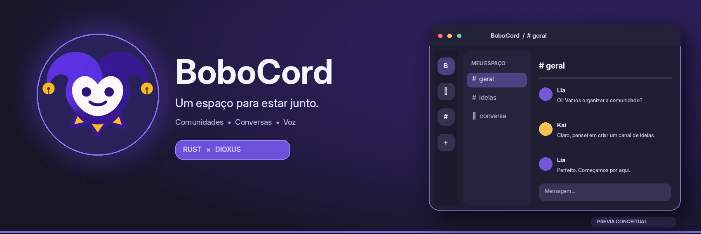

  

  <a href="docs/STATUS.md"><strong>Progresso</strong></a> &nbsp;·&nbsp;
  <a href="docs/PROTOTIPO.md"><strong>Interface</strong></a> &nbsp;·&nbsp;
  <a href="https://github.com/Kageko0/BoboCord/releases"><strong>Versões do Client</strong></a>

**BoboCord** é um aplicativo desktop para reunir amigos, conversas e comunidades em um só lugar. Inspirado na praticidade dos comunicadores modernos, está sendo construído com **Rust + Dioxus Desktop** e uma proposta de comunicação direta entre dispositivos sempre que possível.

A identidade é simples: um espaço acolhedor, uma interface enxuta e liberdade para organizar suas conversas.

### O que está tomando forma

| Experiência | Estado atual |
| --- | --- |
| **Amigos e perfil** | Interface implementada |
| **Servidores e canais** | Navegação e organização implementadas |
| **Mensagens diretas e histórico** | Integração implementada; entrega real entre dispositivos pendente |
| **Voz privada e coletiva** | Transporte QUIC/Opus integrado; áudio entre usuários pendente de homologação |
| **Vídeo e compartilhamento de tela** | Planejados |

### Por trás do BoboCord

**Rust** para o núcleo do aplicativo · **Dioxus** para a interface desktop · **SQLite** para persistência local · **QUIC/Opus** para o transporte de áudio.

O desenvolvimento acontece em um ambiente privado. Este repositório apresenta o produto, registra seu avanço e será o canal oficial das versões públicas do **Client**. As ferramentas internas de desenvolvimento não são distribuídas.

### Acompanhe

- [Entregas, etapas e progresso](docs/STATUS.md)
- [Conceito e organização visual do Client](docs/PROTOTIPO.md)
- [Releases do Client para Windows](https://github.com/Kageko0/BoboCord/releases)

> **Em desenvolvimento.** Ainda não existe uma versão pública estável homologada. As imagens de interface são conceituais; funções implementadas no código podem depender de testes reais entre dispositivos.

BoboCord é um projeto independente. Não é afiliado ao Discord. A licença de distribuição e uso ainda será definida.
